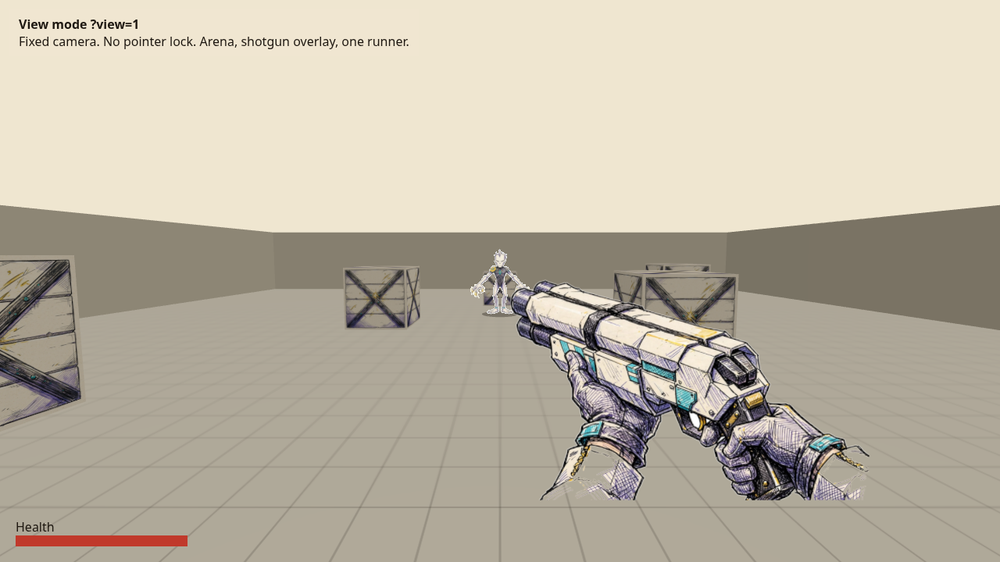
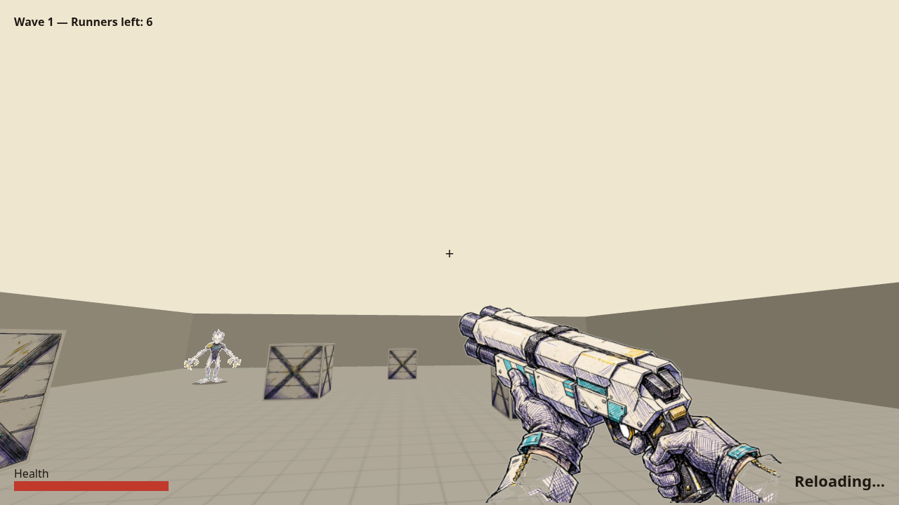
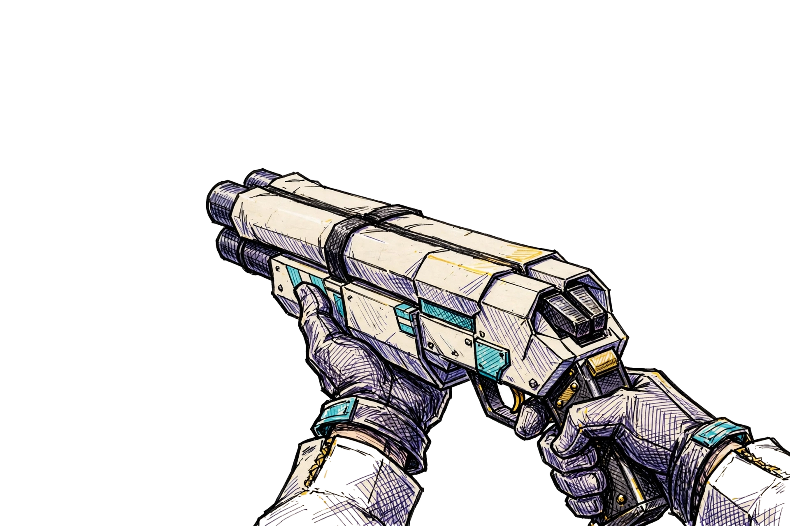
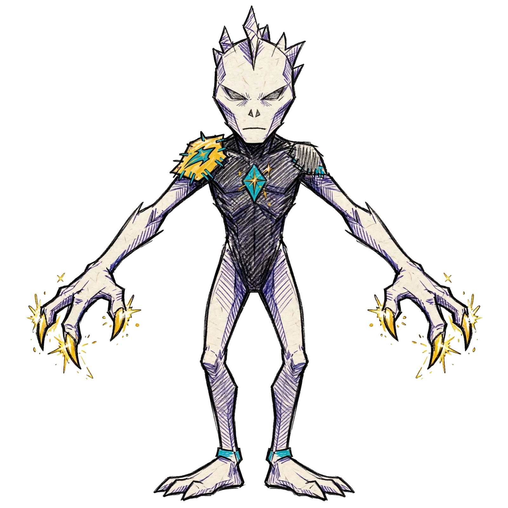
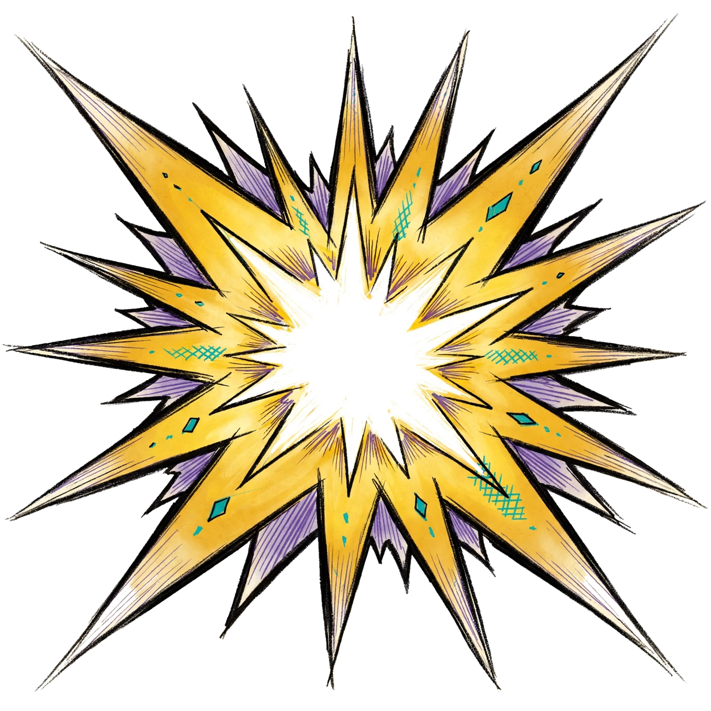
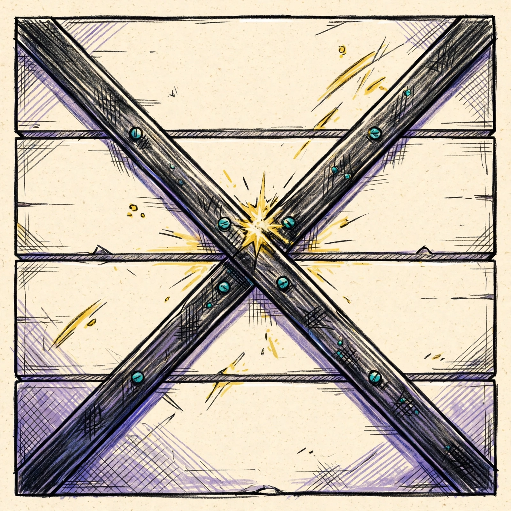
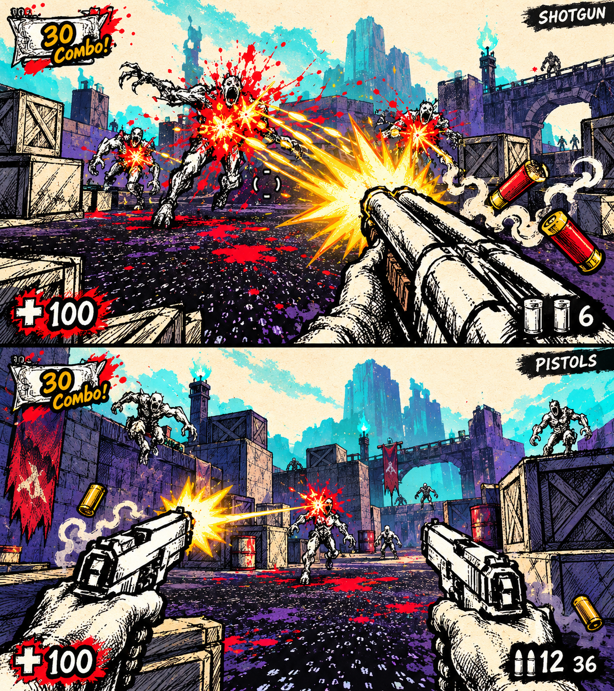
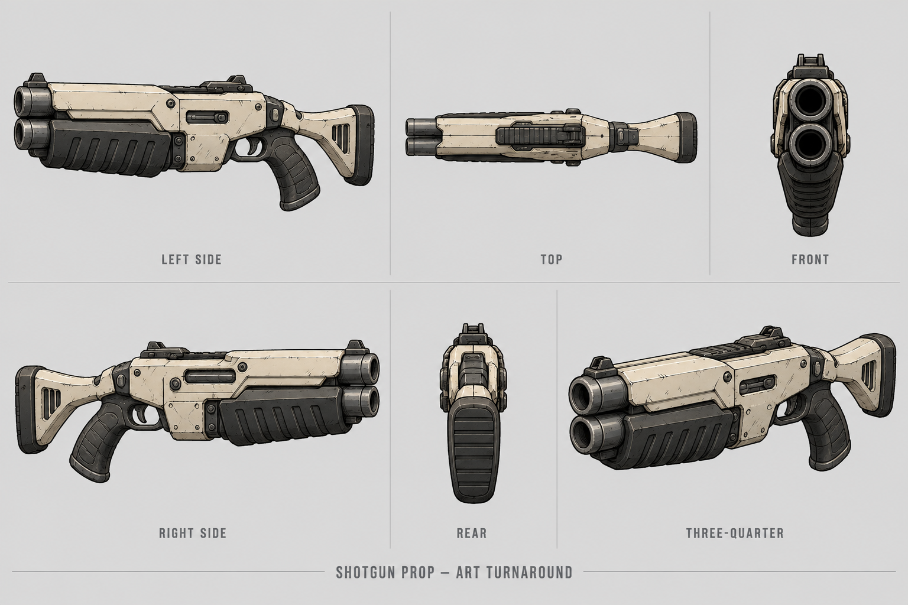

# Paper

Paper-and-ink arcade shooter visual development based on [gun.mp4](gun.mp4).

## Playable vertical slice

The vertical slice in [game/](game/) is playable: one shotgun, one front-view runner, one wave of six runners, in a first-person arena with crates and walls. Run it from `game/` with `npm install`, then `npm run dev` or `npm run preview`.

## Game-building and image prompts

- [Master prompt: build the image-based 2.5D web game](docs/GAME_BUILD_PROMPT.md)
- [Image prompt pack: transparent weapons, monsters, effects and scenery](docs/IMAGE_PROMPTS.md)
- [Example sprite/atlas manifest](docs/ASSET_MANIFEST_EXAMPLE.json)

The plan uses a small spatial scene for movement and collision, with image-based weapons, animated enemy cutouts and layered environment art. Start with one shotgun and one monster before expanding the asset library. The vertical slice above is now playable, with newly generated shotgun and runner sprites. The full game described in these documents is still future work.

### Slice sprites

These are the four runtime images used by the slice, after real alpha extraction (see `scripts/make_alpha.py`). The raw generator files stay under each `raw/` folder.

## Gameplay concepts

Three generated boards explore richer colors and distinct combat effects while retaining the original ink-and-paper aesthetic. Each board contains two gameplay concepts.

| Weapons | Reference image |
| --- | --- |
| Shotgun and pistols | [Open board](output/gameplay/01-shotgun-pistols.png) |
| Automatic gun and blaster | [Open board](output/gameplay/02-automatic-blaster.png) |
| Grenades and throwing knives | [Open board](output/gameplay/03-throwables-knives.png) |

[Video analysis and effect direction](output/gameplay/analysis.md) · [Generation prompts](output/gameplay/generation-prompts.md)

## Shotgun modeling reference

[Six-view shotgun sheet](output/shotgun/shotgun-turnaround.png) · [Blender setup notes](output/shotgun/README.md) · [Generation prompt](output/shotgun/generation-prompt.md)

The sheet is an interpreted prop variant. Its top view conflicts with the vertically stacked barrels shown in the other views; prioritize the front and side views when modeling. Bottom and rear three-quarter views are not included.

## Video reference frames

- [Contact sheet sampled across the video](output/reference/contact-sheet.jpg)
- [Gameplay reference frame](output/reference/gameplay-reference.png)
- [Sampled firing sequence](output/reference/shooting-sequence.jpg)

Images were created with built-in image generation as visual concepts. The repository now contains a playable vertical slice in `game/`. It does not yet contain a Blender model or the full game. The original video is unchanged.
