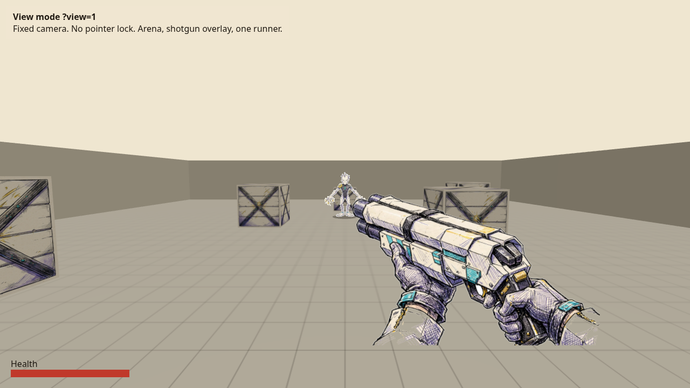
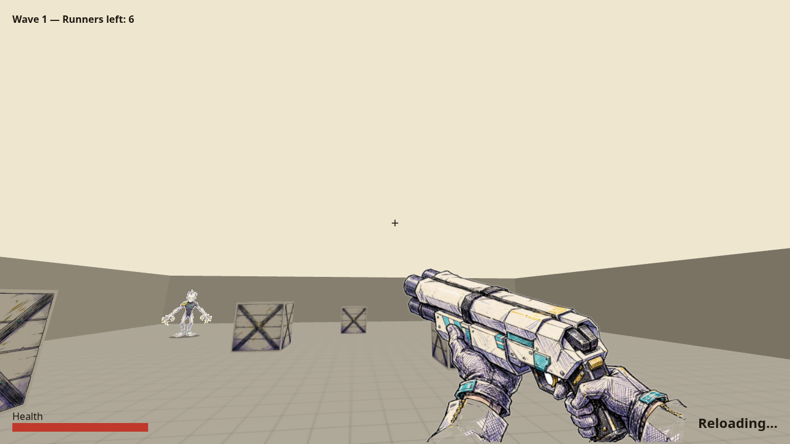
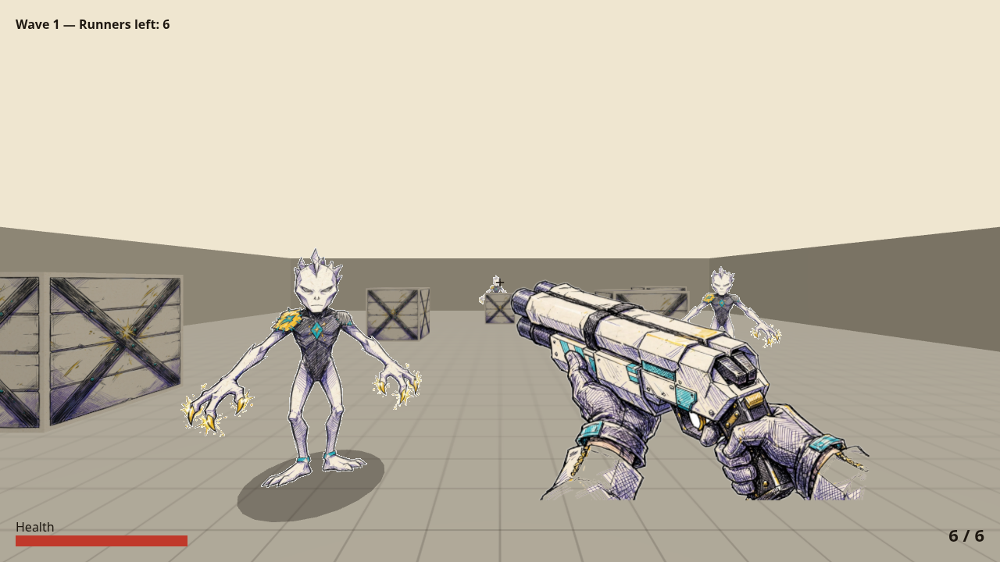
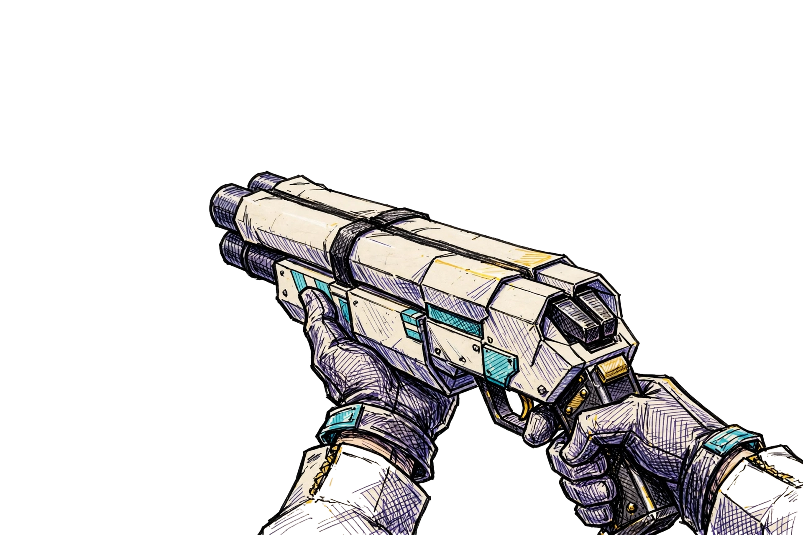
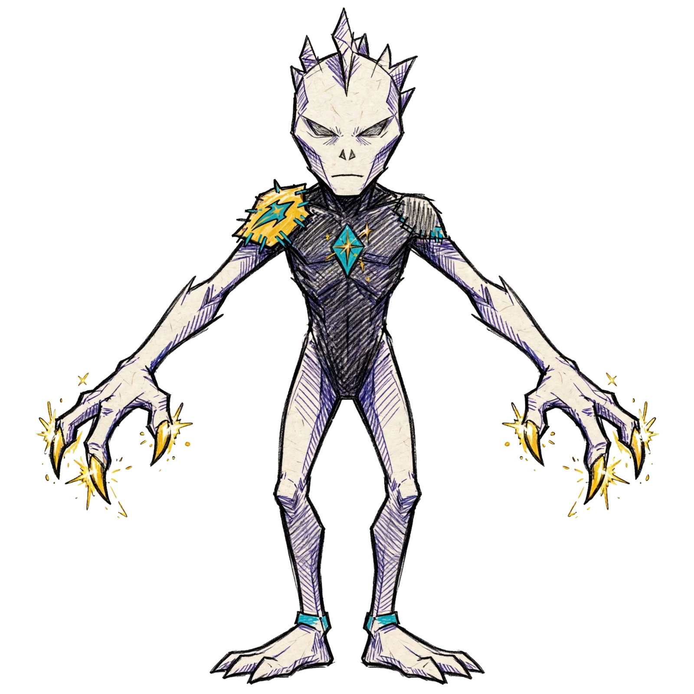
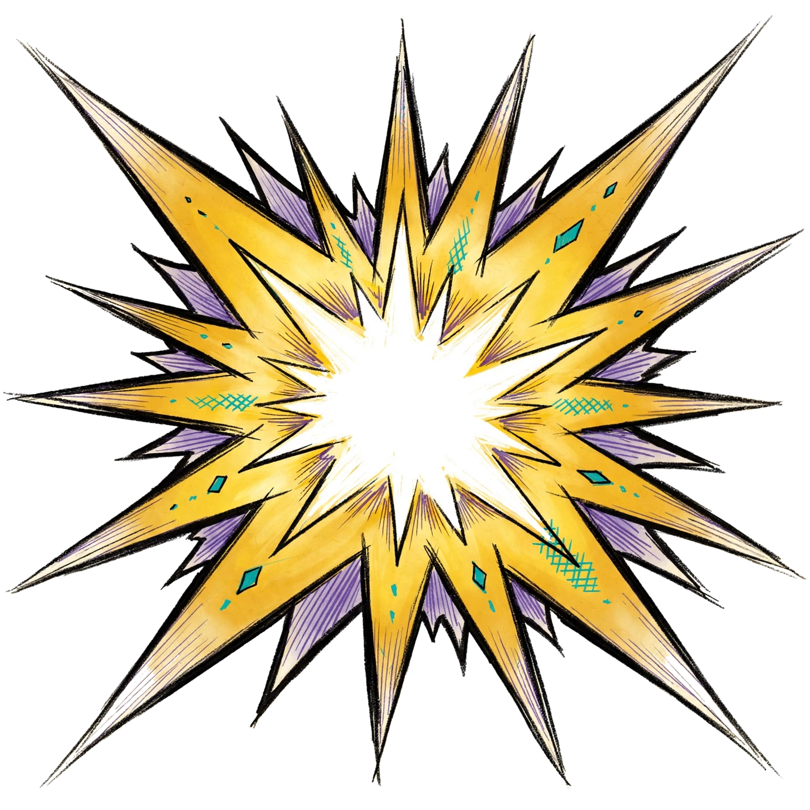
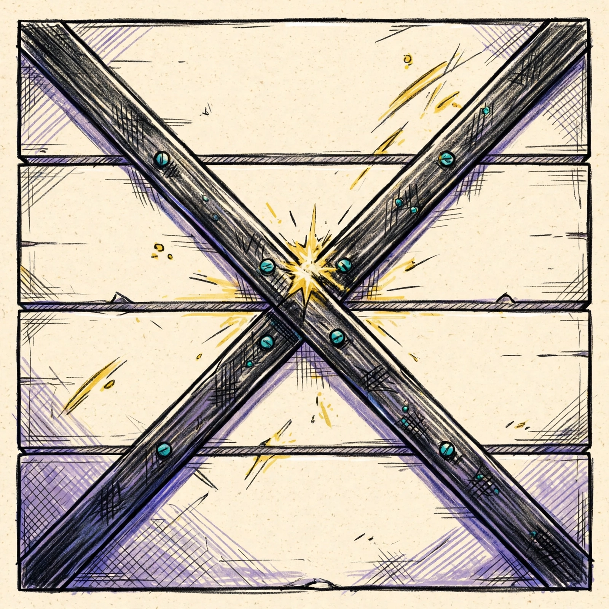

# Paper vertical slice

First-person 2.5D arena shooter built with Vite, TypeScript and Three.js 0.186.0. Current audited commit: 6f109f2. One shotgun, eight-direction animated runner, waves, score/combo, pickups, synthesized sound, settings, sprint, double jump, dash, grapple and melee.

See [current fix.md](../fix.md), the [latest actual gameplay capture](verification/audit-2026-10-31/gameplay-desktop.png), and the [reference-matched art/UI implementation prompt](../docs/PUNCHY_INK_GAME_PROMPT.md). The screenshots below and VERIFICATION.md describe the original milestone; later pass reports under verification/ record later work.

## Screenshots

The full asset review sheet is in [verification/review-1.png](verification/review-1.png). It shows each runtime image on light, dark, and checker backgrounds, with pivot and muzzle points marked.

## Run and build

Run `npm ci`, then `npm run dev` for development. Run `npm run build` before `npm run preview` to serve the production build on port 5174. Run `npm test` (same as `npm run check`) for the portable regression suite in verification/fix-n08-n11/verify.mjs. It builds, starts its own preview server, and drives headless Chromium. Set PAPER_BROWSER to a Chromium executable path, PAPER_PORT for the preview port (default 5181), PAPER_BASE_URL to override the base URL, and PAPER_OUT_DIR to override the report and screenshot directory. Historical verify scripts under verification/ keep their own hardcoded paths and are labeled historical; they are not the current entry point. Current audit results are in verification/audit-2026-10-31/.

## Controls

WASD moves. Mouse aims. Left click fires the shotgun. R reloads. Shift sprints. Space jumps; a second press in the air double jumps. Q dashes. Hold E to grapple and release to detach. F performs melee. Escape pauses. Click Start to enter pointer lock. Desktop keyboard/mouse are required; touch controls are not implemented.

## Verification modes

`?view=1` renders a fixed scene without pointer lock. `?view=2` shows independently phased animated runners. `?review=1` provides asset/clip review, playback and stepping. `?debug=1` exposes the existing inspection/setup API used by browser checks; controlled test setups are not ordinary player actions.

## Files

`src/main.ts` owns the loop, input, and phases. `src/assets.ts` owns the manifest, texture creation, and alpha logging. `src/arena.ts` owns the floor, crates, walls, and collision. `src/enemy.ts` owns the runner state machine. `src/weapon.ts` owns the first-person shotgun overlay, recoil spring, and muzzle flash sprite. `assets.json` is the real manifest for this slice.

## Runtime images

The current manifest has 107 images under `public/assets/`, including runner directions, attack/defeat, gun/fire effects and environment layers. The original `public/assets/effects/muzzle_flash_shotgun.png` and `public/assets/scenery/crate_face.png` are no longer in the runtime manifest, because no clip, environment entry, or source file references them; their masters remain in the repo `assets/` tree outside `game/public/`. The other two original assets remain part of its history and base states:

- `public/assets/weapons/shotgun/shotgun_idle.png`, pivot bottom, muzzle attachment at [0.27, 0.36].
- `public/assets/monsters/runner/runner_front.png`, pivot at the feet, front view only.

Nothing under `output/` is used as a runtime texture. Those files are references only.

## Placeholders

Remaining gaps and mismatches are documented in the root fix.md. In particular:

- Impact sparks, tracers, and dust are procedural canvas and point effects.
- The environment images exist but do not match the original dark-ground/cyan-depth reference closely enough.
- Run, front attack/defeat and gun firing are animated; reload is still an idle-sprite dip, and hit reaction uses the old idle image.
- Audio is synthesized with Web Audio rather than recorded sound assets.
- The new audit reproduces aerial melee overreach and stale off-ledge grounding, and identifies grapple selection/velocity improvements.
- Additional weapons, throwables, other monster families, final comic HUD and proper explosion gameplay remain future work. The new source-art guides under output/punchy-ink-v2/ are not in the runtime manifest.
